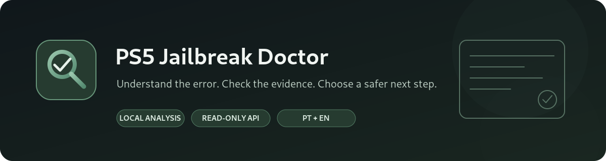

**A Windows desktop diagnostic tool for the PS5 homebrew community.**

Read logs, identify known error patterns, review evidence, and decide what to check next.

[English](README_EN.md) · [Português (Portugal)](README_PT.md)

<p align="center">
  
  
  
  
</p>

## What is it?

**PS5 Jailbreak Doctor** helps troubleshoot problems reported by PS5 homebrew tools, especially log patterns associated with ShadowMountPlus and KStuff Lite. It is designed for both beginners and experienced users: import a log or read the latest logs from a PS5 on your local network, run the analysis, and open a finding to see the matched evidence and suggested next steps.

It is a **diagnostic assistant, not a jailbreak or exploit**. It does not install payloads, change firmware, install games, or automatically apply fixes to the console.

## At a glance

| Collect | Analyze | Understand |
|---|---|---|
| Import `.log`, `.txt`, or `.json` files, or read supported logs from ShadowMountPlus | Match log patterns against a local knowledge base | Review the evidence, estimated confidence, known limitations, and suggested checks |


*Example of the results view. This capture illustrates the interface with sample data; it is not a claim that these errors are present on every console.*

## Features

- **Rule-based log analysis:** checks logs against a locally stored JSON knowledge base containing patterns and references collected from public reports.
- **ShadowMountPlus integration:** retrieves version information, `debug.log`, and kernel log through either the bundled PS5 relay ELF (recommended; no `config.ini` edits) or the optional direct HTTP API mode.
- **Context-aware findings:** optional firmware, ShadowMountPlus and KStuff Lite versions, storage location, image/folder format, and the moment the issue started can affect a rule's relevance.
- **Evidence first:** findings show the matching evidence, confidence estimate, source status, limits, and recommended next checks.
- **Context-specific compatibility notes:** exact combinations of firmware, ShadowMountPlus/KStuff Lite versions, source type, and trigger can surface separately from log-matched diagnoses. A note is not proof that the error occurred.
- **Read-only scanner inspection:** queries custom scan roots and `manual.lst` sources through supported API endpoints. It does not start a rescan or change settings; older API builds may not expose this information.
- **Error timeline:** highlights the first suspicious log lines in file order without rewriting the original evidence.
- **Verified diagnostic database updates:** manually check for a newer knowledge base, verify its SHA-256 and schema, keep a backup, and roll back locally if needed. Only diagnostic JSON is downloaded; logs are never uploaded.
- **Community-ready reports:** export includes source/database version information and an optional follow-up template for whether a suggested step was tested and worked.
- **Unclassified error lines:** when a log contains likely error/crash wording that has no matching rule, the app can surface it for review instead of silently treating the log as clean.
- **Shareable reports:** export the diagnostic report, with common IP addresses and user-folder paths redacted when anonymization is enabled.
- **Language-aware reports:** exported reports follow the selected interface language; original log evidence is preserved verbatim.
- **Portuguese and English UI:** change the interface language from the top bar.
- **Light and dark themes:** the selected theme is saved locally.
- **Optional reversible local filename tests:** only for the specific `.ffpfs` / `.ffpfsc` filename scenarios supported by the app. These actions rename a file on the Windows PC; they do not edit its contents or directly modify the PS5.

## How it works


The app can analyze imported logs without any network connection. For live logs, the PS5 and PC must be on the same trusted local network and ShadowMountPlus' HTTP API must be enabled. The recommended relay mode does not require the API to accept direct LAN connections. API requests are made only when you press a connection, scanner-inspection, or log-fetch button. Scanner inspection uses read-only endpoints and does not trigger a rescan.


*Connection panel example. The console IP shown in the original capture has been replaced with a placeholder.*

## Quick start for Windows users

1. Open the repository's **Releases** page and download `PS5HomebrewDoctor.exe` from the latest release. The source ZIP is for developers and is not the easiest way to run the app.
2. Run the executable. No Python installation or `.bat` file is required for the compiled release.
3. Choose **Import logs** to analyze files on your PC, or open **PS5 connection**. On first use, enter the PS5's current LAN IP (saved locally) and click **Connect automatically**. A compatible payload loader must be active on the console, usually on TCP port `9021`.
4. Doctor looks for an active relay; if none is found, it sends the bundled relay ELF and waits for it to start. When the app confirms the connection, press **Get logs and analyze**.
5. Open a finding to read the matched lines and the suggested next checks. Export a report when asking the community for help.

If there is no published Release yet, see [Building the Windows executable](#building-the-windows-executable) below.

## Connecting to ShadowMountPlus

The recommended mode uses the bundled `PS5JailbreakDoctorRelay.elf` so the Windows app can read logs without requiring manual edits to `/data/shadowmount/config.ini`:

1. Start ShadowMountPlus and ensure its API is enabled. The documented 1.7 defaults are `api_enabled=1` and `api_bind_address=127.0.0.1`.
2. In the app's connection tab, select **ELF relay** and enter the PS5's current LAN IP the first time (saved locally afterwards).
3. Make sure a compatible payload loader is listening, usually on TCP `9021`, then click **Connect automatically**. The app first looks for an existing relay; if there isn't one, it sends the bundled ELF and waits for it to become available.
4. Once connected, press **Get logs and analyze**. The relay exposes read-only diagnostic routes on TCP `10102` and discovery via UDP `10103`.

The relay reads the current config but never writes to it. It can also provide a loopback alias for `127.0.0.1:10101` when the API has been bound to a specific console IP, helping preserve the bundled ShadowMountPlus launcher. The relay must be loaded again after a full console reboot unless a payload autoloader is already in use.

If `api_enabled=0`, the relay will not silently change it. Enable the API using a supported ShadowMountPlus UI option where available, or make a deliberate manual configuration change. Direct API mode is retained as a fallback for builds that have LAN access enabled already.

**Security note:** the API has no user authentication. The relay only forwards the read-only diagnostic endpoints and accepts private IPv4 clients, but logs can contain identifiers. Use a trusted private network only, and never forward TCP `10102` or UDP `10103` to the Internet. Do not expose the ShadowMountPlus API port publicly.

## What the results mean

- **A recognized pattern is a lead, not proof.** The same text can appear in different contexts or on different versions.
- **Confidence is an estimate.** It reflects the available rule/evidence and is not a statistical guarantee.
- **A low-confidence or unclassified result needs more context.** Include the full log, relevant firmware/tool versions, and the exact action that triggered the problem.
- **Fixes are not automatic.** The app provides recommendations for the user to review. It does not write changes to the PS5 through the API.

## Updating diagnostic knowledge

Open **More options → Update diagnostic database** to check for a newer knowledge base. The app downloads only `knowledge_base.json` from this repository after you confirm, checks the SHA-256 listed in `updates.json`, validates the schema and English translations, and stores the new database in your per-user app-data folder. The previous database is backed up locally and can be restored through **More options → Restore previous diagnostic database**. This does not update the executable. No log, report, console address, or personal data is sent by the update check.

The update manifest must be published alongside the matching `knowledge_base.json` file on the default branch. If those files are not yet published, the updater will not find the new manifest.

## Privacy and safety

- Logs are analyzed locally by default; the app does not automatically upload them to a project server.
- Network access is used only for the explicit ShadowMountPlus API actions started by the user.
- The optional report anonymization replaces common IP addresses and Windows/Linux user-folder paths. Review a report before sharing it because custom paths, usernames in other formats, title IDs, and other identifiers may remain.
- The API has no authentication. Use it only on a trusted local network.
- Back up important files before using any local rename test. The app records these changes and blocks rollback if a conflicting original file exists or the renamed file has changed.

## Download or build

### Download the EXE

The GitHub Actions workflow builds a single-file Windows x64 executable when the source is pushed or a workflow is run manually. When a GitHub Release is published, the workflow attaches `PS5HomebrewDoctor.exe` and its SHA-256 file to the release. The EXE is not commercially code-signed, so Windows SmartScreen may show a warning.

### Build from source on Windows

Requires Python 3.12 for the documented build environment and a network connection to install PyInstaller.

To include one-click connection, first compile `ps5-relay/relay.c` with the [official PS5 Payload SDK](https://github.com/ps5-payload-dev/sdk) and place the output at `ps5-relay/build/PS5JailbreakDoctorRelay.elf`. Then run:

```powershell
py -3.12 -m pip install --upgrade pyinstaller
py -3.12 -m PyInstaller --noconfirm --clean --onefile --windowed --name PS5HomebrewDoctor --add-data "knowledge_base.json;." --add-data "ps5-relay/build/PS5JailbreakDoctorRelay.elf;payloads" app.py
```

The generated executable is created in `dist\PS5HomebrewDoctor.exe`. The maintained GitHub Actions workflow is the recommended release path because it builds the relay ELF with a pinned SDK, validates the source files, includes the knowledge base, runs regression tests, and attaches SHA-256 checksums.

### Run from source

Requires Python 3.10 or later. The UI and analysis use Python's standard library.

```powershell
py -3.12 app.py
```

## Project files

- `app.py` — desktop UI and ShadowMountPlus API integration.
- `doctor_core.py` — diagnostic engine, evidence handling, and report generation.
- `knowledge_base.json` — editable local error-pattern database.
- `safe_actions.py` — the small set of optional reversible local filename actions.
- `i18n.py` — Portuguese and English interface strings, including translations embedded in updateable rules.
- `updates.py` and `updates.json` — explicit, checksum-validated diagnostic knowledge-base updates; the app executable is not silently updated.
- `CHANGELOG.md` — user-facing project changes by version.
- `tests/` — regression tests for localization, diagnosis, compatibility notes, and update validation.
- `UPDATES.md` — maintainer instructions for publishing database updates.
- `relay_client.py` — LAN discovery and sending the relay ELF to a compatible console payload loader.
- `ps5-relay/relay.c` — read-only relay and loopback alias for ShadowMountPlus.
- `.github/workflows/build-windows-exe.yml` — builds the PS5 relay ELF with the official SDK and packages it into the Windows release.
- `FONTES_PT.md` — public references used for knowledge-base rules.

## Scope and disclaimer

This is community-created, experimental diagnostic software. It is not affiliated with, endorsed by, or supported by Sony Interactive Entertainment, PlayStation, etaHEN, ShadowMountPlus, or the KStuff Lite maintainers. Names belong to their respective owners. Use the tool and any suggested action at your own risk; check original sources and confirm that a recommendation applies to your versions before changing files or settings.

## License

Released under the MIT License. See [`LICENSE.txt`](LICENSE.txt).
