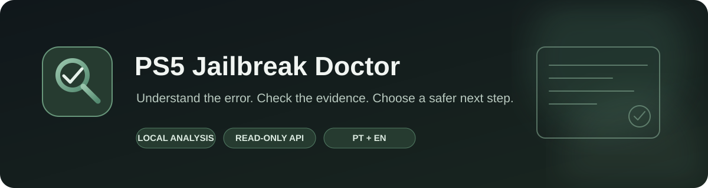
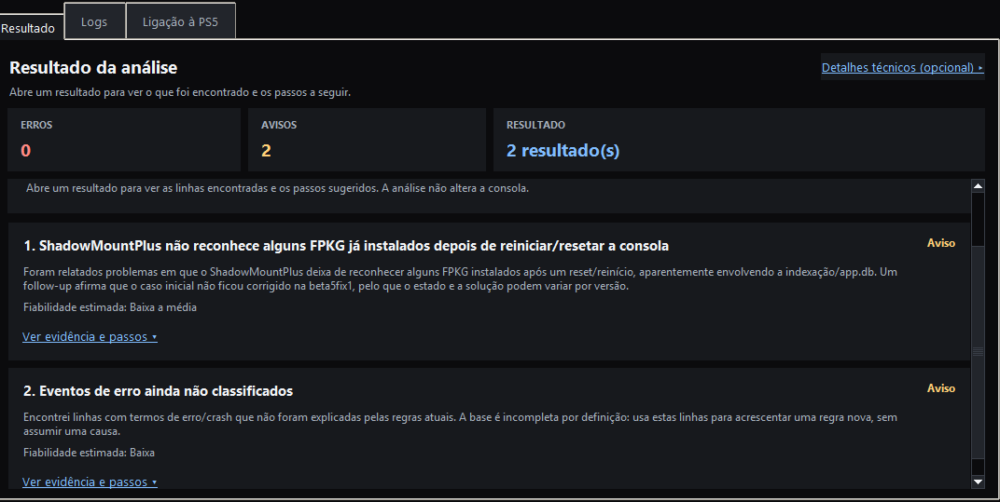
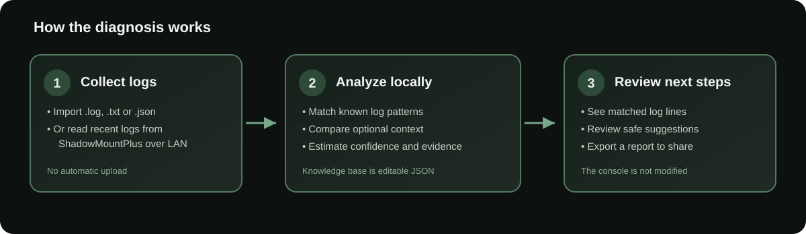
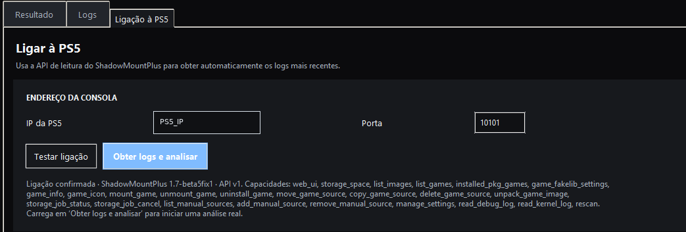

<div align="center">
  

  **A Windows desktop diagnostic tool for the PS5 homebrew community.**

  Read logs, identify known error patterns, review evidence, and decide what to check next.

  [English](README_EN.md) · [Português (Portugal)](README_PT.md)
</div>

<p align="center">
  
  
  
  
</p>

## What is it?

**PS5 Jailbreak Doctor** helps troubleshoot problems reported by PS5 homebrew tools, especially log patterns associated with ShadowMountPlus and KStuff Lite. It is designed for both beginners and experienced users: import a log or read the latest logs from a PS5 on your local network, run the analysis, and open a finding to see the matched evidence and suggested next steps.

It is a **diagnostic assistant, not a jailbreak or exploit**. It does not install payloads, change firmware, install games, or automatically apply fixes to the console.

## At a glance

| Collect | Analyze | Understand |
|---|---|---|
| Import `.log`, `.txt`, or `.json` files, or read supported logs from ShadowMountPlus | Match log patterns against a local knowledge base | Review the evidence, estimated confidence, known limitations, and suggested checks |



*Example of the results view. This capture illustrates the interface with sample data; it is not a claim that these errors are present on every console.*

## Features

- **Rule-based log analysis:** checks logs against a locally stored JSON knowledge base containing patterns and references collected from public reports.
- **ShadowMountPlus integration:** optionally retrieves the version information, `debug.log`, and kernel log through the tool's HTTP API on the local network.
- **Context-aware findings:** optional firmware, ShadowMountPlus and KStuff Lite versions, storage location, image/folder format, and the moment the issue started can affect a rule's relevance.
- **Evidence first:** findings show the matching evidence, confidence estimate, source status, limits, and recommended next checks.
- **Unclassified error lines:** when a log contains likely error/crash wording that has no matching rule, the app can surface it for review instead of silently treating the log as clean.
- **Shareable reports:** export the diagnostic report, with common IP addresses and user-folder paths redacted when anonymization is enabled.
- **Portuguese and English UI:** change the interface language from the top bar.
- **Light and dark themes:** the selected theme is saved locally.
- **Optional reversible local filename tests:** only for the specific `.ffpfs` / `.ffpfsc` filename scenarios supported by the app. These actions rename a file on the Windows PC; they do not edit its contents or directly modify the PS5.

## How it works



The app can analyze imported logs without any network connection. To fetch logs automatically, the PS5 and PC must be on the same trusted local network and the ShadowMountPlus API must be configured to accept the connection. API requests are made only when you press a connection or log-fetch button.



*Connection panel example. The console IP shown in the original capture has been replaced with a placeholder.*

## Quick start for Windows users

1. Open the repository's **Releases** page and download `PS5JailbreakDoctor.exe` from the latest release. The source ZIP is for developers and is not the easiest way to run the app.
2. Run the executable. No Python installation or `.bat` file is required for the compiled release.
3. Choose **Import logs** to analyze files from your PC, or open **PS5 connection** and enter the console's IP address and API port.
4. Press **Test connection**. When the app confirms the connection, press **Get logs and analyze**.
5. Open a finding to read the matched lines and the suggested next checks. Export a report when asking the community for help.

If there is no published Release yet, see [Building the Windows executable](#building-the-windows-executable) below.

## Connecting to ShadowMountPlus

- Start ShadowMountPlus on the PS5 and confirm the API is enabled in the version you are running.
- Configure the API to listen on a trusted LAN interface rather than only on `127.0.0.1`, if the installed build supports this setting.
- In the app, enter the PS5's current LAN IP and the API port configured on the console. The default port used by the app is `10101`, but your configuration may differ.
- Test the connection before fetching logs.

**Security note:** the ShadowMountPlus API used here has no authentication in the supported integration. Keep it limited to a trusted private network, never forward the API port from your router, and do not expose it to the public Internet. The app does not configure the PS5 API for you.

## What the results mean

- **A recognized pattern is a lead, not proof.** The same text can appear in different contexts or on different versions.
- **Confidence is an estimate.** It reflects the available rule/evidence and is not a statistical guarantee.
- **A low-confidence or unclassified result needs more context.** Include the full log, relevant firmware/tool versions, and the exact action that triggered the problem.
- **Fixes are not automatic.** The app provides recommendations for the user to review. It does not write changes to the PS5 through the API.

## Privacy and safety

- Logs are analyzed locally by default; the app does not automatically upload them to a project server.
- Network access is used only for the explicit ShadowMountPlus API actions started by the user.
- The optional report anonymization replaces common IP addresses and Windows/Linux user-folder paths. Review a report before sharing it because custom paths, usernames in other formats, title IDs, and other identifiers may remain.
- The API has no authentication. Use it only on a trusted local network.
- Back up important files before using any local rename test. The app records these changes and blocks rollback if a conflicting original file exists or the renamed file has changed.

## Download or build

### Download the EXE

The GitHub Actions workflow builds a single-file Windows x64 executable when the source is pushed or a workflow is run manually. When a GitHub Release is published, the workflow attaches `PS5JailbreakDoctor.exe` and its SHA-256 file to the release. The EXE is not commercially code-signed, so Windows SmartScreen may show a warning.

### Build from source on Windows

Requires Python 3.12 for the documented build environment and a network connection to install PyInstaller.

```powershell
py -3.12 -m pip install --upgrade pyinstaller
py -3.12 -m PyInstaller --noconfirm --clean --onefile --windowed --name PS5JailbreakDoctor --add-data "knowledge_base.json;." app.py
```

The generated executable is created in `dist\PS5JailbreakDoctor.exe`. The maintained GitHub Actions workflow is the recommended release path because it also validates the source files, includes the knowledge base, and attaches a SHA-256 checksum.

### Run from source

Requires Python 3.10 or later. The UI and analysis use Python's standard library.

```powershell
py -3.12 app.py
```

## Project files

- `app.py` — desktop UI and ShadowMountPlus API integration.
- `doctor_core.py` — diagnostic engine, evidence handling, and report generation.
- `knowledge_base.json` — editable local error-pattern database.
- `safe_actions.py` — the small set of optional reversible local filename actions.
- `i18n.py` — Portuguese and English interface strings.
- `.github/workflows/build-windows-exe.yml` — Windows x64 packaging workflow.
- `FONTES_PT.md` — public references used for knowledge-base rules.

## Scope and disclaimer

This is community-created, experimental diagnostic software. It is not affiliated with, endorsed by, or supported by Sony Interactive Entertainment, PlayStation, etaHEN, ShadowMountPlus, or the KStuff Lite maintainers. Names belong to their respective owners. Use the tool and any suggested action at your own risk; check original sources and confirm that a recommendation applies to your versions before changing files or settings.

## License

Released under the MIT License. See [`LICENSE.txt`](LICENSE.txt).
