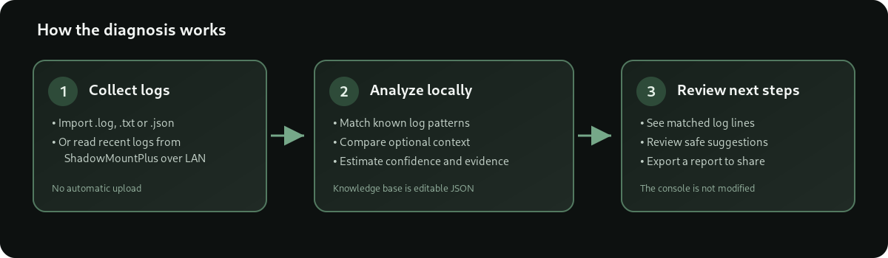

# PS5 Jailbreak Doctor

**O PS5 Jailbreak Doctor é uma aplicação de diagnóstico para Windows destinada à comunidade de homebrew da PS5.** Analisa logs, procura padrões de erro conhecidos associados a ferramentas como ShadowMountPlus e KStuff Lite, apresenta a evidência encontrada e sugere verificações seguintes.

> **Importante:** é um assistente de diagnóstico, não um jailbreak nem um exploit. Não instala payloads, não altera o firmware, não instala jogos e não aplica correções automaticamente na consola.

[README principal do GitHub](README.md) · [English](README_EN.md)


*Captura ilustrativa da vista de resultados com dados de exemplo — não significa que estes erros estejam presentes em todas as consolas.*

## O que faz

- **Analisa ficheiros de logs:** permite importar ficheiros `.log`, `.txt` e `.json` para análise local.
- **Obtém logs da PS5:** opcionalmente, liga-se à API HTTP do ShadowMountPlus na rede local para consultar a versão e obter o `debug.log` e o kernel log.
- **Deteta padrões conhecidos:** compara as linhas encontradas com uma base de conhecimento local em `knowledge_base.json`, que pode ser ampliada por contribuidores.
- **Usa contexto adicional:** firmware, versões do ShadowMountPlus e KStuff Lite, localização do jogo (USB/SSD interno), formato (pasta/imagem) e o momento em que o erro começou podem ajudar a avaliar a relevância de uma regra.
- **Explica cada resultado:** mostra evidências, confiança estimada, estado da fonte, limitações e passos sugeridos.
- **Evidência em primeiro lugar:** os resultados mostram as linhas correspondentes, o nível de confiança estimado, as limitações e os passos seguintes.
- **Notas de compatibilidade contextual:** combinações exatas de firmware, versões de ShadowMountPlus/KStuff Lite, formato da origem e momento do erro podem gerar avisos separados dos diagnósticos encontrados nos logs. Uma nota não prova que o erro aconteceu.
- **Verificação do scanner, só de leitura:** consulta as raízes personalizadas e as origens de `manual.lst` através dos endpoints suportados da API. Não inicia uma nova varredura nem altera configurações; versões antigas podem não disponibilizar estes dados.
- **Cronologia de erros:** destaca as primeiras linhas suspeitas pela ordem do ficheiro, preservando o texto original.
- **Atualizações verificadas da base de diagnósticos:** procura manualmente uma base mais recente, valida o SHA-256 e o esquema JSON, guarda uma cópia anterior e permite reverter. Só transfere regras; nunca envia logs.
- **Relatórios para a comunidade:** incluem a versão da base e um modelo opcional para indicar se os passos foram testados e se resolveram o problema.
- **Sinaliza erros ainda desconhecidos:** se encontra termos associados a erros/crashes sem regra correspondente, pode mostrá-los para análise posterior.
- **Exporta relatórios:** permite guardar um relatório para partilhar com a comunidade. A opção de anonimização oculta endereços IP e formatos comuns de caminhos de utilizador.
- **Respeita o idioma escolhido:** os relatórios são gerados em português ou inglês conforme o idioma da interface; a evidência original dos logs é mantida sem alterações.
- **Inclui português e inglês**, bem como temas claro e escuro com preferência guardada localmente.
- **Oferece algumas renomeações locais reversíveis:** apenas para cenários de nomes de ficheiros `.ffpfs`/`.ffpfsc previstos pela aplicação. A ação muda o nome do ficheiro no PC; não altera o seu conteúdo nem escreve diretamente na PS5.

## Como funciona



A análise de logs importados funciona localmente e não exige ligação à consola. Para obter logs automaticamente, o PC e a PS5 têm de estar na mesma rede local de confiança e a API do ShadowMountPlus tem de aceitar ligações pela rede.


*A captura original foi editada para substituir o endereço IP privado por um marcador.*

## Utilização rápida

### Analisar logs que já tens no PC

1. Abre o programa.
2. Escolhe **Importar logs** e seleciona um ou mais ficheiros suportados.
3. Clica em **Analisar logs**.
4. Abre cada resultado para ver as linhas encontradas, as limitações e os próximos passos.
5. Guarda um relatório para o partilhares num tópico ou com os mantenedores da ferramenta relevante.

### Obter logs diretamente da PS5

1. Inicia o ShadowMountPlus na consola e confirma que a API está ativa.
2. Se a tua versão o exigir, configura a API para aceitar ligações através de uma interface de rede local, em vez de apenas `127.0.0.1`.
3. No separador de ligação, indica o IP LAN atual da PS5 e a porta da API. A aplicação usa `10101` por defeito, mas a configuração pode ser diferente.
4. Clica em **Testar ligação**. Quando a aplicação confirmar a ligação, escolhe **Obter logs e analisar**.
5. Consulta os resultados e exporta um relatório se precisares de ajuda.

### Segurança da ligação

A integração usa a API do ShadowMountPlus, incluindo `/api/v1/version`, `/api/v1/debug-log` e `/api/v1/kernel-log`. A API não tem autenticação na integração suportada. Mantém-na limitada a uma rede local de confiança, nunca encaminhes a porta no router e não a exponhas à Internet. A aplicação não configura a API pela tua conta.

## Como interpretar os resultados

- Um padrão reconhecido é **uma pista**, não uma prova definitiva da causa.
- A confiança é uma estimativa baseada na regra e na evidência disponível, não uma garantia estatística.
- Um resultado com baixa confiança ou não classificado precisa de contexto: log completo, firmware, versões e a ação exata que causou o problema.
- As sugestões são apresentadas para avaliação pelo utilizador. O programa não altera a PS5 através da API.


## Atualizar a base de diagnósticos

Em **Mais opções → Atualizar base de diagnósticos**, a aplicação procura uma versão mais recente. Depois de confirmares, transfere apenas `knowledge_base.json` deste repositório, valida o SHA-256 indicado em `updates.json`, verifica o esquema e as traduções inglesas e guarda a nova base na pasta de dados do utilizador. A versão anterior fica guardada localmente e pode ser restaurada em **Mais opções → Reverter atualização da base**. O executável não é atualizado automaticamente e nenhum log, relatório ou endereço da consola é enviado.

O ficheiro `updates.json` tem de ser publicado em conjunto com a versão correspondente de `knowledge_base.json` no ramo principal. Se estes ficheiros ainda não estiverem publicados, a atualização não estará disponível através da aplicação.

## Privacidade e segurança

- Por defeito, os logs são analisados localmente; não são enviados automaticamente para um servidor do projeto.
- A ligação à consola só acontece quando carregas num botão de ligação ou recolha.
- A anonimização do relatório substitui endereços IP e caminhos comuns de pastas de utilizador. Antes de partilhar, revê o relatório: caminhos personalizados, nomes de utilizador noutros formatos, Title IDs e outros identificadores podem permanecer.
- A API do ShadowMountPlus não tem autenticação; usa-a apenas numa rede privada de confiança.
- Antes de executar uma renomeação local, confirma o ficheiro selecionado e guarda cópia de segurança se for importante. A aplicação bloqueia a reversão quando existe um conflito de nome ou o ficheiro foi modificado após a ação.

## Instalar e executar

### Executável Windows

Na página **Releases** do repositório, descarrega `PS5JailbreakDoctor.exe` da versão mais recente. O executável compilado não exige Python nem ficheiros `.bat` no computador do utilizador.

O workflow do GitHub Actions compila o programa para Windows x64 e, quando é publicada uma Release, anexa o executável e o respetivo ficheiro SHA-256. O executável não tem assinatura comercial; o Windows SmartScreen pode mostrar um aviso.

### Executar a partir do código-fonte

Requer Python 3.10 ou posterior. A interface e a análise usam a biblioteca padrão do Python.

```powershell
py -3.12 app.py
```

### Compilar o EXE no Windows

Para a compilação documentada, utiliza Python 3.12 e instala o PyInstaller:

```powershell
py -3.12 -m pip install --upgrade pyinstaller
py -3.12 -m PyInstaller --noconfirm --clean --onefile --windowed --name PS5JailbreakDoctor --add-data "knowledge_base.json;." app.py
```

O ficheiro resultante é criado em `dist\PS5JailbreakDoctor.exe`. Para publicações oficiais, recomenda-se o workflow incluído em `.github/workflows/build-windows-exe.yml`, que valida os ficheiros, inclui a base de conhecimento e anexa um checksum SHA-256 à Release.

## Estrutura do projeto

| Ficheiro | Função |
|---|---|
| `app.py` | Interface Windows e integração com a API do ShadowMountPlus |
| `doctor_core.py` | Motor de diagnóstico, evidências e relatórios |
| `knowledge_base.json` | Base local de padrões de erro, com fontes e recomendações |
| `safe_actions.py` | Conjunto limitado de renomeações locais reversíveis |
| `i18n.py` | Textos da interface em português e inglês |
| `updates.py` / `updates.json` | Atualizações explícitas da base com verificação SHA-256 |
| `UPDATES.md` | Guia para publicar atualizações da base de diagnósticos |
| `tests/` | Testes de regressão para traduções, diagnósticos e atualizações |
| `CHANGELOG.md` | Alterações do projeto organizadas por versão |
| `.github/workflows/build-windows-exe.yml` | Compilação do EXE para Windows x64 |
| `FONTES_PT.md` | Referências públicas usadas nas regras da base de conhecimento |

## Limitações conhecidas

A base de conhecimento não cobre todos os erros possíveis e os relatos comunitários podem ser específicos de uma versão ou firmware. A aplicação não consegue garantir que uma sugestão resolva o problema. Confirma sempre as fontes originais e verifica a compatibilidade antes de alterar ficheiros ou configurações.

## Licença e aviso legal

O projeto é distribuído ao abrigo da licença MIT; consulta [`LICENSE.txt`](LICENSE.txt).

Este é um projeto comunitário experimental. Não é afiliado, patrocinado ou apoiado pela Sony Interactive Entertainment, PlayStation, etaHEN, ShadowMountPlus ou pelos responsáveis do KStuff Lite. As marcas pertencem aos respetivos proprietários. Utiliza o programa por tua conta e risco.
